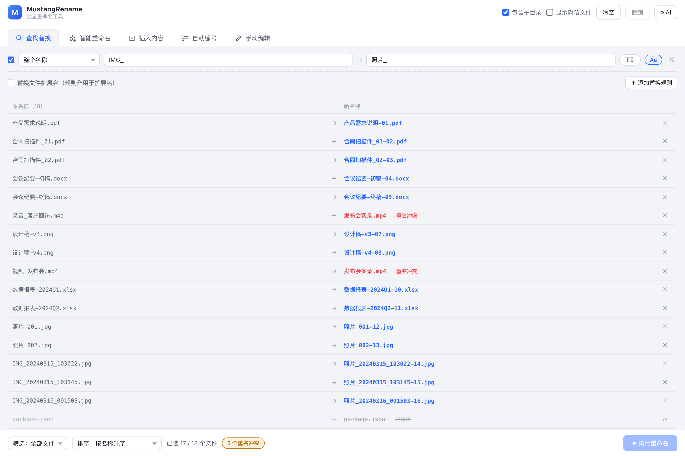
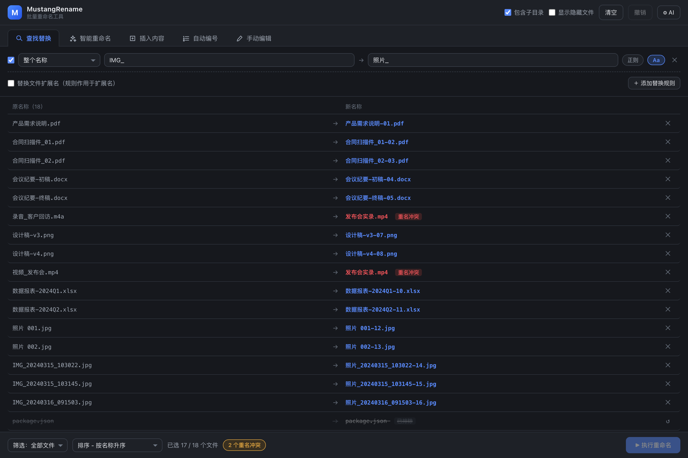

# MustangRename ("马上改名" in Chinese)

A cross-platform (macOS / Windows) desktop batch file renaming tool built with Tauri 2 + Vue 3 + TypeScript. ~10MB installer, instant startup. A rule engine covers everyday renaming needs, and the built-in AI smart rename generates new names for an entire batch from a one-sentence rule description.

**[Chinese](./README.md)** | **[English](./README.en.md)**





## Features

### Loading files
- Drag & drop files or folders into the window; multiple root directories at once
- Or pick via the top bar "Select Files / Select Folder" dialogs
- Options: include subdirectories, show hidden files

### Renaming rules (five tabs, stackable)
The rule chain runs in the order **Find & Replace → Insert Content → Auto Numbering**. AI and manual edits act as override layers with priority: **Manual > AI > Rule chain**.

1. **Find & Replace**: 8 target regions (whole name / first N chars / last N chars / N chars from position X / content before or after a character, or N chars of it); regex and case-sensitivity toggles; multiple stacked rules
2. **Smart Rename (AI)**: describe the rule in one sentence (e.g. "translate Chinese to English", "device + capture time", "video duration + bitrate") and the AI produces a new name for every file in the current list; multi-turn refinement supported ("#3 is too long", "use 3-digit numbers"); results land in the preview and only apply on execute
3. **Insert Content**: three content sources × five positions (start / end / before position X / after a character / before a character)
   - Fixed text
   - Sequence: Arabic (zero-padded) / Chinese lowercase (一, 十一) / Chinese uppercase (壹, 拾壹) / English uppercase (A, AA) / English lowercase; configurable start value
   - File info: created time / modified time (`YYYYMMDD`, `YYYY-MM-DD`, `YYYYMMDD_HHMMSS`, `YYYY-MM-DD_HH-MM-SS`) / file size (auto unit or raw bytes)
4. **Auto Numbering**: start / step / zero-pad digits / prefix / suffix / position (numbering order = current list sort order)
5. **Manual Edit**: per-file full new name; drag the row handle to reorder (switches to custom order, which drives sequences and numbering); paste multi-line text (e.g. a column copied from Excel) to fill names downward from the current row

### Preview & safety
- Live side-by-side preview of old → new names
- Duplicate conflicts, illegal characters and empty names are flagged in red and block execution
- Per-file exclude / restore
- One-click undo with a multi-step rollback stack
- "Replace file extension" toggle: when off, rules only touch the base name and extensions are preserved

### Sorting & filtering
- 9 sort modes: name / size / modified time / created time × asc/desc, plus custom order (drag)
- Filters: keyword / extension list (e.g. `vue, ts`) / regex

### AI configuration
- Three protocols: `openai-completions` (POST /chat/completions), `openai-responses` (POST /responses), `anthropic-messages` (POST /messages)
- Config name, Base URL, API key; fetch the model list into a dropdown or type a model manually; one-click connection test
- Config is stored only in local localStorage; requests go through a local Rust proxy on desktop and a dev-server proxy during development, so browser CORS never gets in the way

### Misc
- Light / dark theme follows the system preference
- Browser preview mode: try the UI and rule effects without installing Rust (execution disabled)

## Quick start

### Requirements

| Environment | Requirement |
| --- | --- |
| Node.js | ≥ 18 |
| Rust | stable ≥ 1.90 (MSRV of tauri 2.12; rustup recommended) |
| macOS | Xcode Command Line Tools: `xcode-select --install` |
| Windows | VS 2022 C++ Build Tools; WebView2 (preinstalled on Win10/11) |

### Complete walkthrough (from zero)

```bash
# 1. Clone the repository
git clone https://github.com/<your-username>/MustangRename.git
cd MustangRename

# 2. Install Node.js (>= 18): download from nodejs.org, or
brew install node              # macOS
# Windows: winget install OpenJS.NodeJS.LTS

# 3. Install Rust (>= 1.90)
curl --proto '=https' --tlsv1.2 -sSf https://sh.rustup.rs | sh -s -- -y
source "$HOME/.cargo/env"

# 4. Install frontend dependencies
npm install

# 5. Develop / package
npm run tauri dev              # desktop dev mode
npm run tauri build            # artifacts in src-tauri/target/release/bundle/
```

Per-platform extras:

- macOS: `xcode-select --install` (Xcode Command Line Tools)
- Windows: VS 2022 C++ Build Tools with the "Desktop development with C++" workload; WebView2 ships with Win10/11

### Start development

```bash
npm install
npm run tauri dev      # desktop window (first Rust compile takes a few minutes)
```

Browser preview mode (no Rust needed; UI and rule preview only):

```bash
npm run dev            # open http://localhost:1420
```

### Commands

| Command | Description |
| --- | --- |
| `npm run tauri dev` | Desktop dev mode with hot reload |
| `npm run tauri build` | Build installers |
| `npm run dev` | Frontend only, browser preview mode |
| `npm run typecheck` | vue-tsc type check |
| `npm run icons` | Regenerate app icons (pure Node, no dependencies) |

### Offline / restricted networks

For fully offline / air-gapped deployments (offline Rust bundle + vendored crates) and mirror setups when the official sources time out, see [docs/offline-setup.md](docs/offline-setup.md).

## Packaging & distribution

```bash
npm run tauri build
```

Artifacts:

- macOS: `src-tauri/target/release/bundle/dmg/*.dmg`, `src-tauri/target/release/bundle/macos/*.app`
- Windows: `src-tauri/target/release/bundle/nsis/*.exe`, `src-tauri/target/release/bundle/msi/*.msi`

Signing notes:

- **Windows**: unsigned installers trigger SmartScreen; users can choose "More info → Run anyway". Code signing is recommended for public distribution
- **macOS**: unsigned/unnotarized apps are blocked by Gatekeeper: right-click → Open, or System Settings → Privacy & Security → Open Anyway. Public distribution requires an Apple Developer account for signing + notarization

macOS universal binary (Apple Silicon + Intel):

By default the bundle only contains the host architecture. To produce a universal binary that runs natively on both chips:

```bash
rustup target add x86_64-apple-darwin        # one-time
npm run tauri build -- --target universal-apple-darwin
# verify: lipo -archs src-tauri/target/universal-apple-darwin/release/bundle/macos/MustangRename.app/Contents/MacOS/MustangRename
```

## Project structure

```
src/
  rules/engine.ts        Rule engine (region slicing, replace, sequence/time/size text, insert, numbering, validation)
  composables/fs.ts      Filesystem adapter (Tauri commands / browser DataTransfer traversal)
  composables/ai.ts      AI request building & response parsing for 3 protocols, model list, lenient JSON name parsing
  stores/rules.ts        Rule chain and manual-edit state
  stores/ai.ts           AI config (localStorage persistence), conversation, AI name layer
  stores/files.ts        Scanning, sorting (incl. custom), filtering, preview, conflict detection, execute, undo
  components/            Top bar / rule tabs (5) / file list / bottom bar / drop overlay / AI settings modal
src-tauri/
  src/lib.rs             scan_paths, rename_files, http_json (AI request proxy, bypasses CORS)
scripts/gen-icons.mjs    PNG/ICO/ICNS icon generator
```

## Development guide

### Adding a new rename rule type
1. `src/types.ts`: define the rule interface and add it to the `Rule` union
2. `src/rules/engine.ts`: add a branch in `applyRule` (keep it a pure function)
3. `src/stores/rules.ts`: add a `defaultXxx()` factory and include it in `orderedRules()`
4. `src/components/panels/`: create the panel component and register the tab in `RulePanel.vue`
5. Run `npm run typecheck`, then open a PR

### Code checks
Run `npm run typecheck` before committing; Rust changes are checked by `cargo` during dev/build.

## FAQ

- **macOS says the app is damaged / cannot be opened**: expected for unsigned builds; right-click → Open, or `xattr -cr /Applications/MustangRename.app`
- **Windows SmartScreen blocks the installer**: unsigned build notice; "More info → Run anyway"
- **Browser preview mode cannot execute renames**: by design — browsers cannot see absolute paths; use the desktop app for execute/undo
- **AI model list fetch fails**: check the Base URL (up to the version prefix, e.g. `https://api.openai.com/v1`), protocol and key; restart the dev server after editing `vite.config.ts`
- **First compile is slow**: the Tauri + reqwest dependency tree has hundreds of crates; only the first build is slow
- **Build fails with `rustc 1.87 is not supported … tauri@2.12 requires rustc 1.90`**: the Rust toolchain is too old. Run `brew update && brew upgrade rust`, or `rustup update stable` if you use rustup; verify `rustc --version` ≥ 1.90 and rebuild. Avoid `cargo update --precise` downgrades: tauri itself requires 1.90, so the whole dependency chain would have to be pinned to old versions
- **rustup fails with `could not amend shell profile` / permission denied**: some rc file (e.g. `.tcshrc`) has unusual ownership; rerun the installer with `--no-modify-path` and add `. "$HOME/.cargo/env"` to your shell rc (e.g. `~/.zshrc`) manually

## Contributing

Issues and pull requests are welcome. Small fixes can go straight to a PR; please open an issue first for new features or large refactors. Make sure `npm run typecheck` passes before submitting.

## Roadmap

- Rule presets: save / import / export (JSON)
- EXIF capture time and audio ID3 tags as naming sources
- Rename log export and dry-run reports
- Renaming folders themselves

## Author

Ma Ruifu · [maruifu.com](https://maruifu.com) · [email@maruifu.cn](mailto:email@maruifu.cn)

## License

[MIT](./LICENSE) © Ma Ruifu (maruifu.com)
